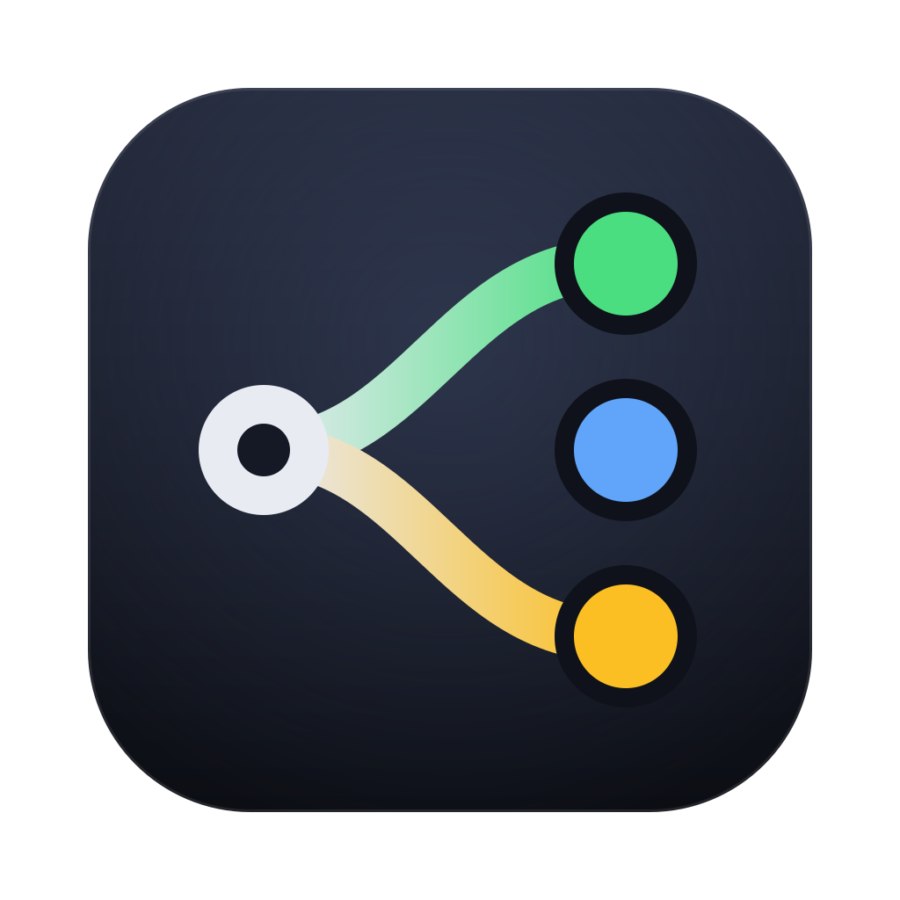
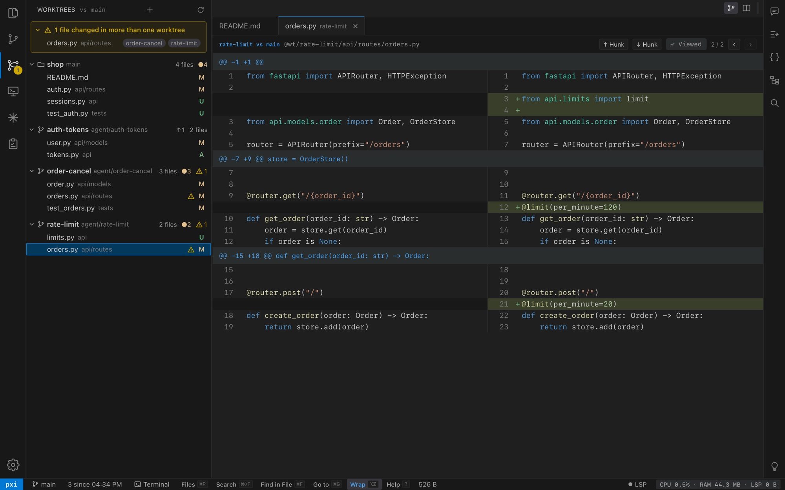
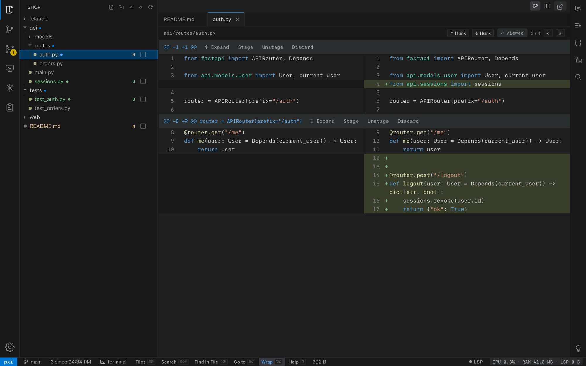
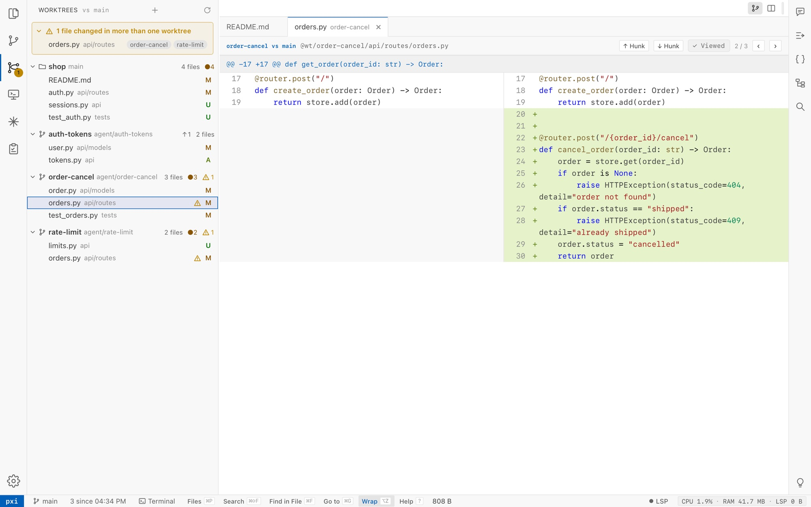

<p align="center">
  
</p>

<h1 align="center">pxi</h1>

<p align="center">
  <b>The review IDE for parallel coding agents.</b><br>
  Run several Claude Code sessions in their own git worktrees, and read, check and
  ship what each one wrote from one fast native Mac window.
</p>

<p align="center">
  <a href="https://snehal96.github.io/pxi/">Website</a> ·
  <a href="docs/pxi/README.md">Docs</a> ·
  <a href="https://github.com/snehal96/pxi/releases/latest">Download</a>
</p>

<p align="center">
  Based on <a href="https://github.com/px0-ai/px0">px0</a>, Arpit Bhayani's in-browser review IDE.
</p>

<p align="center">
  
</p>

## Install

```bash
curl -fsSL https://raw.githubusercontent.com/snehal96/pxi/master/macos/get.sh | bash
```

Installs the latest pxi.app into `/Applications` and opens it (Apple silicon and
Intel, macOS 13+). Run it again to update.

## Why pxi

Agents write code faster than anyone can read it. pxi is built for the reading:

- **Every worktree in one window.** What each agent changed, which files more than one
  of them touches (overlaps), and a walkthrough of each change before you open a file.
- **Review checkpoint.** Mark "now"; every file an agent adds, edits or deletes after
  that gets a dot, committed or not.
- **Claude inside.** Claude Code sessions in an editor tab, with your own login and any
  of your Claude accounts. Its edits show as diffs to accept or reject.
- **Review → agent.** Quote lines from any file or diff into that worktree's Claude
  with your comment (`⌥K`).
- **Fast and small.** A Swift window around one Go binary. No Electron. Opens huge
  repositories instantly and never uses more memory than px0, the engine it is
  built on (checked on every commit).

<table>
  <tr>
    <td width="50%"></td>
    <td width="50%"></td>
  </tr>
  <tr>
    <td align="center">Review checkpoint: dots on what changed since you looked</td>
    <td align="center">Light theme, or follow macOS light/dark</td>
  </tr>
</table>

## Features

| Area | What you get |
|---|---|
| **Worktrees** | All worktrees of a repo with their changes and overlaps; hide or delete stale ones; new worktree with Claude started on a task; **Ship** asks its Claude to commit, push and open a PR |
| **Review** | Split and unified diffs, hunk staging, viewed files, review checkpoint, AI walkthrough of a change, pull requests from GitHub, GitLab, Gitea/Forgejo and Bitbucket |
| **Claude** | Sessions per repo and worktree (`⌘Esc`), Threads with headless Claude on your subscription, one menu entry per logged-in Claude account, notifications and Dock badge when a session needs you |
| **Source Control** | History, branches, stashes, remotes, tags, commit, push and pull |
| **Navigation** | Quick Open with recent files first (`⌘P`), workspace search (`⌘⇧F`), symbols, language servers on demand, `.env` and local config files findable |
| **Terminal & processes** | Shells in the repo or any worktree (`⌃\``); what each session started, with ports, CPU, memory and Stop |
| **Remote (SSH)** | Browse and read files on another machine over your SSH keys, read-only; saved and reconnected automatically |
| **Look** | VS Code-style layout, themes, follows macOS light/dark, explorer indent guides, HTML and Markdown preview |

The full list, with shortcuts: [docs/pxi](docs/pxi/README.md).

## Other ways to install

**Zip:** download `pxi-mac.zip` from
[Releases](https://github.com/snehal96/pxi/releases/latest), unzip, move pxi.app to
Applications, then right-click it and choose **Open** the first time (the app is not
notarized yet).

**From source:** builds with Go, Bun and the Xcode command line tools, installing
any that are missing.

```bash
bash -c "$(curl -fsSL https://raw.githubusercontent.com/snehal96/pxi/master/macos/install.sh)"
```

**Command line / browser (macOS, Linux):**

```bash
make build && install pxi ~/.local/bin/
pxi                                    # the workbench in your browser
pxi ~/code/project                     # one folder
pxi https://github.com/owner/repo/pull/123
```

Open folders with **File → Open Folder…** (`⌘O`), by dropping one on the Dock icon,
or `open -a pxi ~/code/project`. Settings live in `~/.pxi/settings.json`.

## Security

pxi listens on `127.0.0.1` only, refuses requests addressed to another host name
(DNS rebinding) and writes from other websites, never follows a symlink out of the
folder you opened, and never sends saved tokens back to the page. Details:
[MAINTAINING.md](MAINTAINING.md#security-fixes-pxi-carries-fork_securitygo).

## Contributing

pxi is a soft fork of px0 that merges upstream weekly. Read
[MAINTAINING.md](MAINTAINING.md) and [CLAUDE.md](CLAUDE.md) before changing code.

## Acknowledgements

pxi is built on [px0](https://github.com/px0-ai/px0) by Arpit Bhayani, used under the
MIT License; see [LICENSE](LICENSE). px0's own documentation, which still describes
the engine underneath, is in [docs/](docs/README.md).
